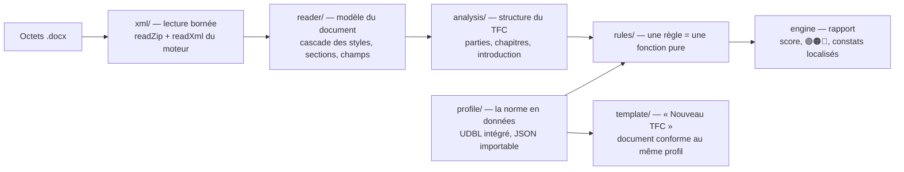

# @intellieditor/conformity

Moteur de conformité d'IntelliEditor : il vérifie qu'un document Word (.docx) respecte la norme
de rédaction d'un TFC — par défaut celle de la Faculté des Sciences Informatiques de l'UDBL — et
dit précisément où et pourquoi il ne la respecte pas.

Le moteur ne dépend ni de React ni de l'éditeur : il lit des octets DOCX et rend un rapport. Le
même code tourne dans l'éditeur (panneau « Conformité ») et en ligne de commande.

## Architecture



| Couche      | Rôle                                                                                                                                  | Dépend de                         |
| ----------- | ------------------------------------------------------------------------------------------------------------------------------------- | --------------------------------- |
| `xml/`      | Frontière de confiance : zip et XML lus par les lecteurs bornés du moteur (anti zip-bomb, pas de DTD/entités), noms d'espaces résolus | `@docx-editor.dev/core/store`     |
| `model/`    | Ce que les règles voient : paragraphes, sections, mise en forme résolue                                                               | —                                 |
| `reader/`   | XML → modèle, en appliquant la cascade de styles de Word                                                                              | `xml/`, `model/`                  |
| `analysis/` | Retrouve le squelette du TFC (liminaires, introduction, chapitres…)                                                                   | `model/`, `profile/`              |
| `profile/`  | Toutes les valeurs de la norme ; aucune règle ne contient de constante                                                                | `model/`                          |
| `rules/`    | Une fonction pure par exigence ; `pass`, `fail` (avec constats) ou `skip` (avec raison)                                               | `analysis/`, `model/`, `profile/` |
| `engine.ts` | Orchestration, isolation des règles, score                                                                                            | tout ce qui précède               |
| `template/` | Génère un TFC vierge conforme au profil actif                                                                                         | `profile/`, `core/store`          |

Principes : le moteur est en **lecture seule** (une correction est _décrite_, l'éditeur l'applique
en une étape annulable) ; une règle qui ne peut pas conclure dit **« non vérifiable »** plutôt que
de deviner ; une règle qui plante n'arrête pas les autres.

## Règles (profil UDBL)

| Catégorie           | Règle                                                                                                                                                                                                             | Source           |
| ------------------- | ----------------------------------------------------------------------------------------------------------------------------------------------------------------------------------------------------------------- | ---------------- |
| Mise en page        | Format A4 · marges 3,5/2,5/3,5/2,5 cm (correction automatique) · pages numérotées · numéro au coin droit · numérotation séparée liminaires / corps                                                                | Norme §1.2.1     |
| Typographie         | Times New Roman · 12 pt · interligne 1,25                                                                                                                                                                         | §1.3.1           |
| Titres              | Style par niveau (T1 majuscule gras…) · numérotation des sections (doublons, sauts, mauvais chapitre)                                                                                                             | §1.3.1, §1.1     |
| Structure           | Page de garde · parties obligatoires · ordre · sections de l'introduction · ≤ 4 chapitres · introduction/conclusion partielles · parties vides · table des matières **automatique** · listes des figures/tableaux | §1.1, grille MRS |
| Tableaux et figures | Légende au-dessus des tableaux, sous les figures · numérotation « chapitre.ordre »                                                                                                                                | §1.3.1           |
| Références          | Intitulé « Références » · ≥ 10 sources · citations IEEE `[n]` cohérentes avec la liste                                                                                                                            | §1.4, §1.5       |
| Intégrité           | Aucun « Erreur ! Signet non défini. »                                                                                                                                                                             | —                |
| Longueur            | Introduction ≤ 6 pages · chapitres ≤ 20 pages (estimation)                                                                                                                                                        | §1.1             |

## Utilisation

```bash
# Vérifier un ou plusieurs fichiers (code de sortie 1 si non conforme)
bun packages/conformity/src/cli.ts mon-tfc.docx
bun packages/conformity/src/cli.ts *.docx --json > rapport.json

# Avec une autre norme (JSON partiel, superposé au profil UDBL)
bun packages/conformity/src/cli.ts mon-tfc.docx --profil ma-norme.json

# Régénérer les documents de démonstration de l'application
# (le preload fournit le DOM minimal dont la mise en page de l'éditeur a besoin)
bun --preload ./scripts/test/preload-dom.ts packages/conformity/scripts/make-samples.ts

# Redessiner les figures de l'exemple conforme (Pillow + polices DejaVu)
python3 packages/conformity/scripts/assets/make-figures.py

# Tests
bun test packages/conformity
```

```ts
import { checkDocx, createTfcTemplate, parseProfile } from '@intellieditor/conformity';

const run = checkDocx(bytes); // profil UDBL par défaut
if (run.ok) console.log(run.report.summary); // { level: 'non-conforme', score: 23, … }
```

## Documents de démonstration

`make-samples` écrit dans `examples/vite/public/intellieditor/` :

| Fichier                     | Contenu                                                                                                                                                                                                   | Verdict attendu                |
| --------------------------- | --------------------------------------------------------------------------------------------------------------------------------------------------------------------------------------------------------- | ------------------------------ |
| `tfc-exemple-conforme.docx` | TFC fictif complet : logo UDBL, pages liminaires, introduction en 9 points, 3 chapitres (introductions et conclusions partielles), 5 figures, 5 tableaux, 12 références IEEE citées dans l'ordre, annexes | conforme, 100/100              |
| `tfc-modele-udbl.docx`      | Le squelette de « Nouveau TFC », avec le logo                                                                                                                                                             | à revoir (une seule référence) |
| `tfc-exemple-erreurs.docx`  | Un document volontairement fautif (une section, Calibri, marges, numérotation…)                                                                                                                           | non conforme                   |
| `logo-udbl.png`             | Le logo proposé par défaut dans « Nouveau TFC »                                                                                                                                                           | —                              |

Le générateur est piloté par le contenu (`src/template/content.ts`) : `BodyBuilder` numérote
chapitres, sections, figures et tableaux, et écrit la table des matières et les listes comme de
vrais champs `TOC`. Leurs numéros de page sont calculés par le **moteur de mise en page de
l'éditeur** (`scripts/samples/paginate.ts`, mesure HarfBuzz avec Liberation Serif, métriques de
Times New Roman), en itérant jusqu'à ce qu'ils soient stables.

Les légendes sont écrites comme le fait la commande `insertCaption` de l'éditeur :
`Figure 2.` suivi d'un champ `SEQ Figure \* ARABIC \s 1`. Les listes sont des champs
`TOC \c "Figure"` / `TOC \c "Tableau"`, avec le début et la fin du champ dans des paragraphes
à part. Un document généré se met donc à jour dans l'éditeur (et dans Word) comme un document
écrit à la main.

## Outils de rédaction dans l'éditeur

Trois commandes du moteur (`packages/core`) permettent d'écrire un TFC complet en partant d'un
fichier vide. L'application les expose dans ses menus :

| Menu                                   | Commande                        | Effet                                                                                                                        |
| -------------------------------------- | ------------------------------- | ---------------------------------------------------------------------------------------------------------------------------- |
| Fichier → Numérotation des pages…      | `setPageNumbering`              | Format de la section du curseur (1, i, I, a, A), recommencer à N ou continuer                                                |
| Insertion → Légende…                   | `insertCaption`                 | « Figure 2.1 … » sous l'élément, « Tableau 1.3 … » au-dessus ; les autres légendes sont renumérotées dans la même annulation |
| Insertion → Liste des figures/tableaux | `insertToc` avec `captionLabel` | Liste générée depuis les légendes, mise à jour avec « Mettre à jour la table »                                               |
| Insertion → Renuméroter les légendes   | `updateCaptionNumbers`          | Corrige les numéros après un déplacement ou une suppression                                                                  |

## Profil JSON

Un profil importé ne contient que ce qui change ; le reste vient du profil UDBL. Chaque champ est
vérifié (type, bornes) ; les clés inconnues sont ignorées et signalées. Exemple :

```json
{
  "name": "Mémoire de Licence — autre faculté",
  "page": { "marginsCm": { "left": 3, "top": 2.5 }, "liminaryNumberFormat": "decimal" },
  "typography": { "lineSpacing": 1.5 },
  "references": { "minimumCount": 15 },
  "rules": { "longueur.chapitres": { "enabled": false }, "titres.format": { "severity": "error" } }
}
```

Le bouton « Exporter la norme » du panneau produit le profil complet, point de départ pour en
écrire un nouveau.

## Points à valider avec le directeur

- **Numérotation des pages** : la norme écrite dit « chiffres arabes de l'épigraphe à
  l'avant-propos, romains à partir de l'introduction », mais les TFC validés font l'inverse. Le
  profil suit la pratique (`liminaryNumberFormat: lowerRoman`, `bodyNumberFormat: decimal`) ; une
  ligne du profil suffit à changer.
- **Interligne** « 1,25 pts » lu comme 1,25 ligne.
- **Longueurs** estimées à partir du nombre de mots (≈ 330 mots par page).
